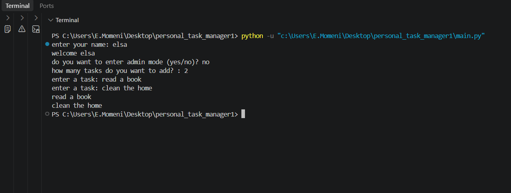
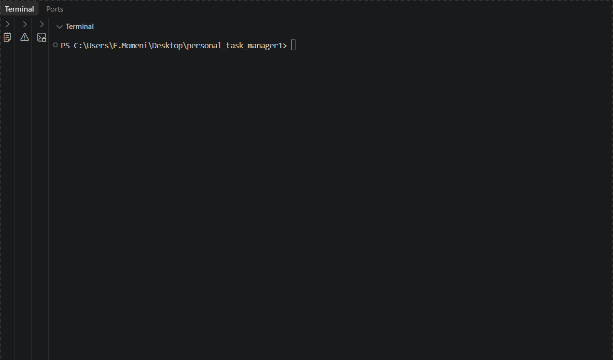

# Personal Task Manager


A simple task manager built with python

# Features
- add multiple tasks
- save tasks
- load saved tasks
- admin mode

## Requirments 
- Python
- python-dotenv


## Project Structure
```text
personal_task_manager1/
│   .env.example
│   .gitignore
│   main.py
│   README.md
│   requirments.txt
│   tasks.py
│
├───Images/
│       Animation.gif
│       image.png
│
```

## Installation
Installl he required packasges:

```bash
python -m pip insall -r requirments.txt
```

## Envioirment setup
create a `.env` file in the project folder

Use `.env.example` as a templete

Add your admin password

```env
admin_pass=your_password_here
```

replace `your_password_here` with your own admin password

## run the program
run the main file:
```bash
python main.py
```
## Screanshot


## Demo
